# 1. Panduan Admin

Panduan ini untuk pengelola konten website. Semua yang tampil di website (produk, artikel, video, FAQ, testimoni, teks, kontak) diatur dari **Panel Admin**, tanpa perlu menyentuh kode.

**Daftar isi**

1. [Masuk ke Panel Admin](#11-masuk-ke-panel-admin)
2. [Mengenal tampilan Admin dan peran pengguna](#12-mengenal-tampilan-admin-dan-peran-pengguna)
3. [Dashboard](#13-dashboard)
4. [Kategori](#14-kategori)
5. [Produk](#15-produk)
6. [Blog (artikel)](#16-blog-artikel)
7. [Video](#17-video)
8. [Testimoni dan link testimoni untuk klien](#18-testimoni-dan-link-testimoni-untuk-klien)
9. [FAQ](#19-faq)
10. [Klien / Mitra](#110-klien--mitra)
11. [Pesan Masuk](#111-pesan-masuk)
12. [Pengguna](#112-pengguna)
13. [Pengaturan Website](#113-pengaturan-website)
14. [Akun saya](#114-akun-saya)
15. [Tanya jawab singkat](#115-tanya-jawab-singkat)

---

## 1.1 Masuk ke Panel Admin

1. Buka `https://domain-anda.com/login`.
2. Isi **Email** dan **Password**, lalu klik tombol masuk.

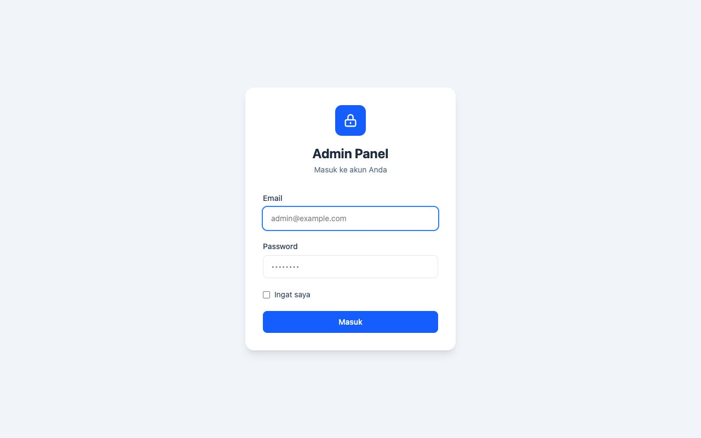

> Akun awal: `admin@example.com` dengan password `password`. **Ganti segera** setelah pertama kali masuk (lihat [Akun saya](#114-akun-saya)).

---

## 1.2 Mengenal tampilan Admin dan peran pengguna

- **Sidebar kiri** berisi semua menu, dikelompokkan menjadi *Konten* (Kategori, Produk, Blog, Video), *Komunitas* (Testimoni, FAQ, Klien / Mitra), dan *Lainnya* (Pesan Masuk, Pengguna, Pengaturan).
- **Pojok kanan atas** ada tombol **Lihat Website** (membuka website di tab baru) dan **menu akun**. Klik nama Anda untuk membuka **Pengaturan akun** atau **Keluar**.

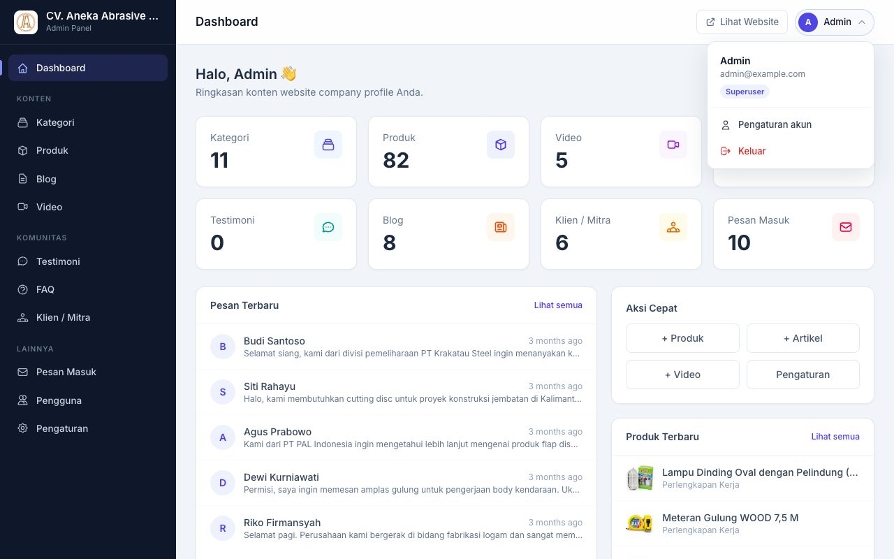

Ada dua peran pengguna:

| Peran | Bisa mengakses |
|---|---|
| **Superuser** | Semua menu, termasuk Kategori, Klien / Mitra, Pengguna, dan Pengaturan |
| **Admin** | Produk, Blog, Video, Testimoni, FAQ, Pesan Masuk, dan akun sendiri |

Admin biasa yang membuka menu khusus Superuser akan dikembalikan ke Dashboard dengan pesan pemberitahuan.

---

## 1.3 Dashboard

Halaman pertama setelah masuk. Isinya ringkasan konten:

- **Kartu angka**: jumlah kategori, produk, video, FAQ, testimoni, blog, klien, dan pesan masuk.
- **Pesan Terbaru**: pesan terakhir dari form kontak. Klik *Lihat semua* untuk membuka Pesan Masuk.
- **Aksi Cepat**: pintasan untuk menambah produk, artikel, video, atau membuka Pengaturan.
- **Produk Terbaru**.

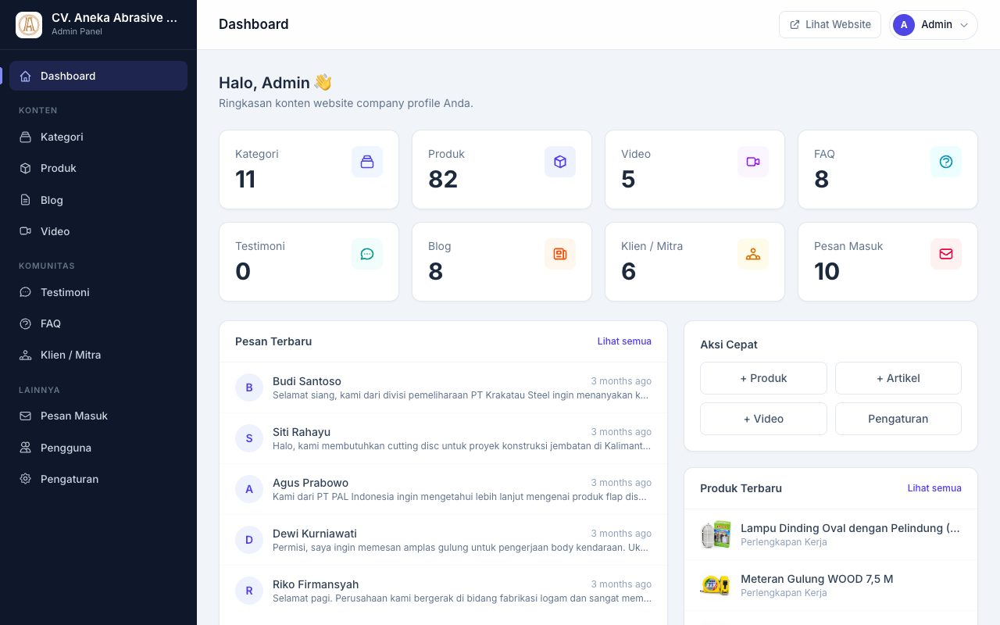

---

## 1.4 Kategori

*Khusus Superuser.* Kategori dipakai untuk mengelompokkan produk. Kategori tampil sebagai kartu di beranda dan sebagai tombol filter di katalog.

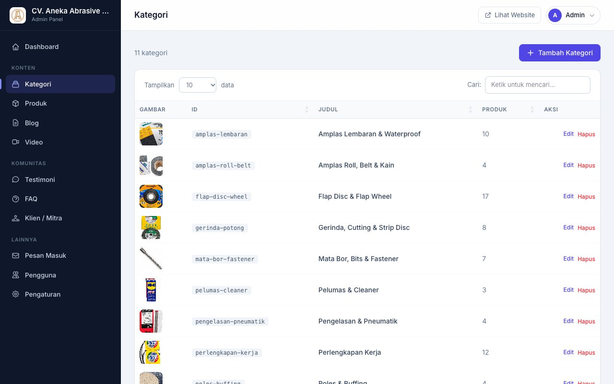

**Menambah kategori:** klik **Tambah**, lalu isi formulir.

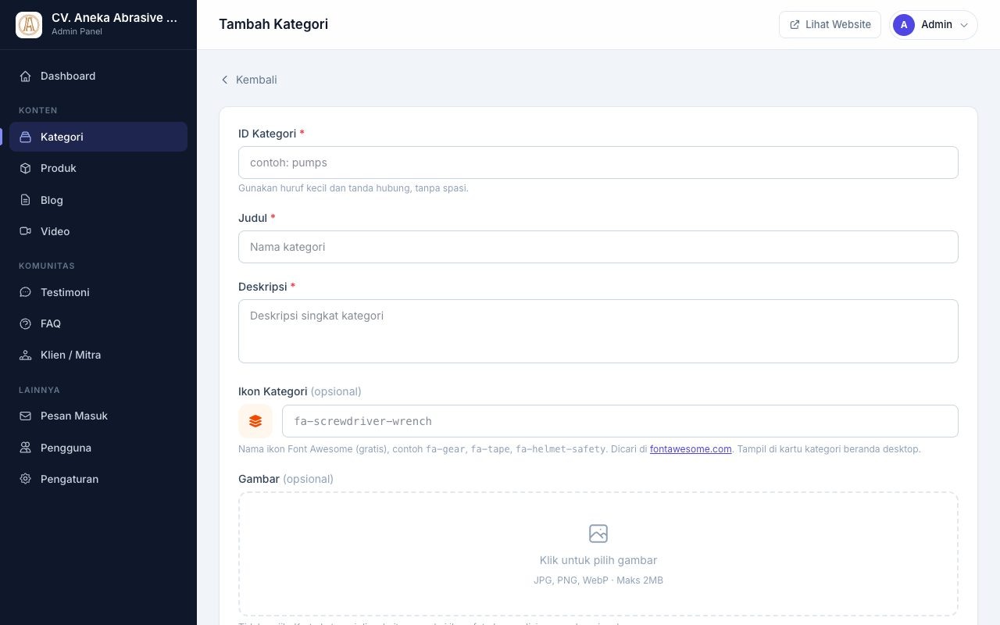

| Kolom | Keterangan |
|---|---|
| **ID Kategori** | Kode singkat huruf kecil tanpa spasi, misalnya `amplas-lembaran`. Harus unik. Dipakai di alamat filter. |
| **Judul** | Nama kategori yang tampil di website. |
| **Deskripsi** | Penjelasan singkat kategori. |
| **Ikon** *(opsional)* | Nama ikon Font Awesome diawali `fa-`, misalnya `fa-screwdriver-wrench`. |
| **Gambar** *(opsional)* | Foto kategori, maksimal 2 MB. |

> Menghapus kategori yang masih berisi produk bisa membuat produk tersebut tidak punya kategori. Pindahkan dulu produknya.

---

## 1.5 Produk

Menu **Produk** untuk mengelola katalog. Di daftar, gunakan kotak pencarian untuk mencari produk berdasarkan judul atau isi.

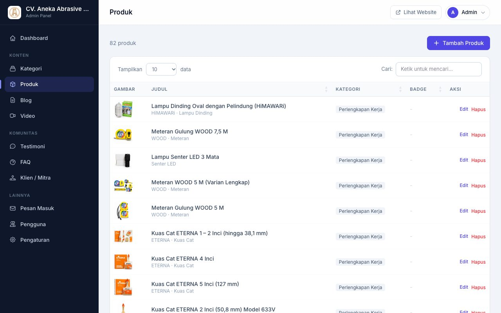

### Menambah produk

Klik **Tambah Produk**, isi formulir, lalu **Simpan**.

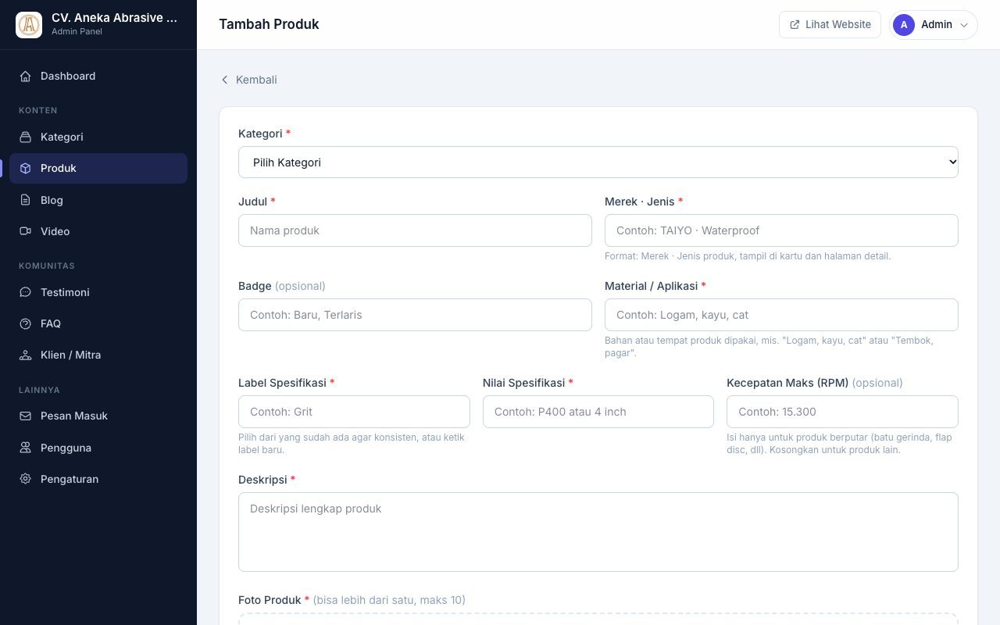

| Kolom | Keterangan dan contoh |
|---|---|
| **Kategori** | Pilih dari daftar kategori. |
| **Judul** | Nama produk. Dari judul inilah alamat produk dibuat otomatis dan **tidak akan berubah** walau judul diedit nanti. |
| **Merek · Jenis** | Format `Merek · Jenis`, misalnya `TAIYO · Waterproof`. Tampil di kartu dan halaman detail. |
| **Badge** *(opsional)* | Label kecil di pojok foto, misalnya `Baru` atau `Terlaris`. |
| **Material / Aplikasi** | Bahan atau tempat produk dipakai, misalnya `Logam, kayu, cat`. |
| **Label Spesifikasi** | Nama spesifikasi utama, misalnya `Grit`, `Ukuran`, atau `Isi`. Pilih dari saran yang muncul agar konsisten. |
| **Nilai Spesifikasi** | Isinya, misalnya `P400` atau `4 inch`. |
| **Kecepatan Maks (RPM)** *(opsional)* | Isi hanya untuk produk berputar (batu gerinda, flap disc). Kosongkan untuk produk lain. |
| **Deskripsi** | Penjelasan produk. |
| **Foto Produk** | 1 sampai 10 foto, maksimal 2 MB per foto. **Foto pertama menjadi sampul** di kartu produk. Foto otomatis dikecilkan agar website tetap cepat. |

### Mengedit produk

Klik **Edit** pada produk. Anda bisa mengubah semua kolom, **menambah foto baru**, atau **menghapus foto** yang ada. Produk harus tetap punya minimal 1 foto.

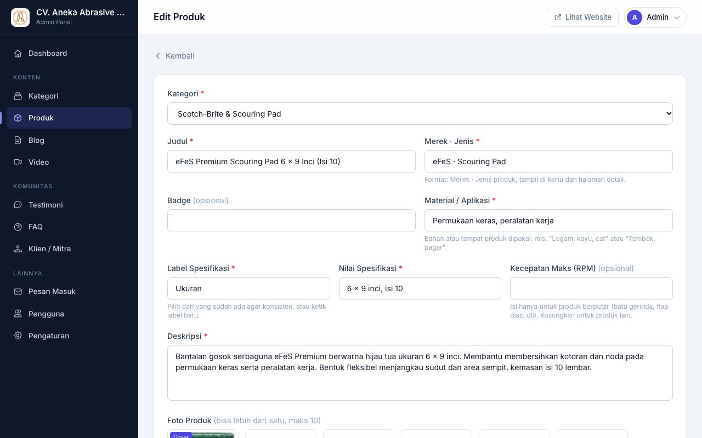

### Menghapus produk

Klik **Hapus** di daftar produk, lalu konfirmasi. Produk yang sudah dihapus tidak bisa dikembalikan.

> **Tips foto:** gunakan foto produk dengan latar bersih dan format persegi supaya kartu produk rapi. Foto yang diunggah otomatis dikecilkan maksimal 1600 piksel.

---

## 1.6 Blog (artikel)

Artikel muncul di bagian Blog di beranda (4 terbaru) dan di halaman `/blog` (semua artikel). Setiap artikel punya alamat sendiri sehingga bisa dibagikan dan ditemukan lewat Google.

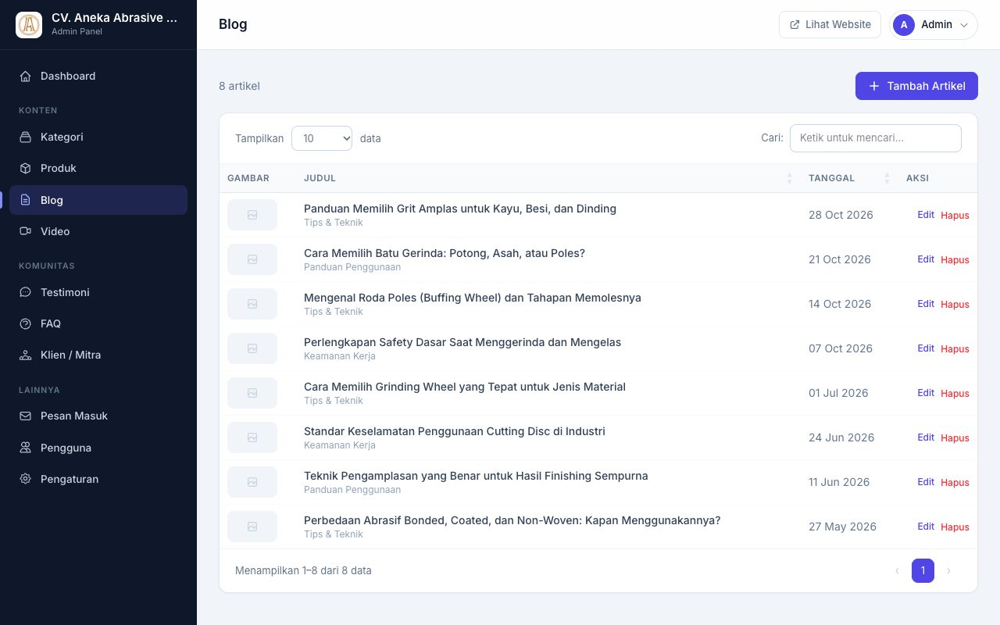

### Menulis artikel

Klik **Tambah**, isi formulir, lalu **Simpan**.

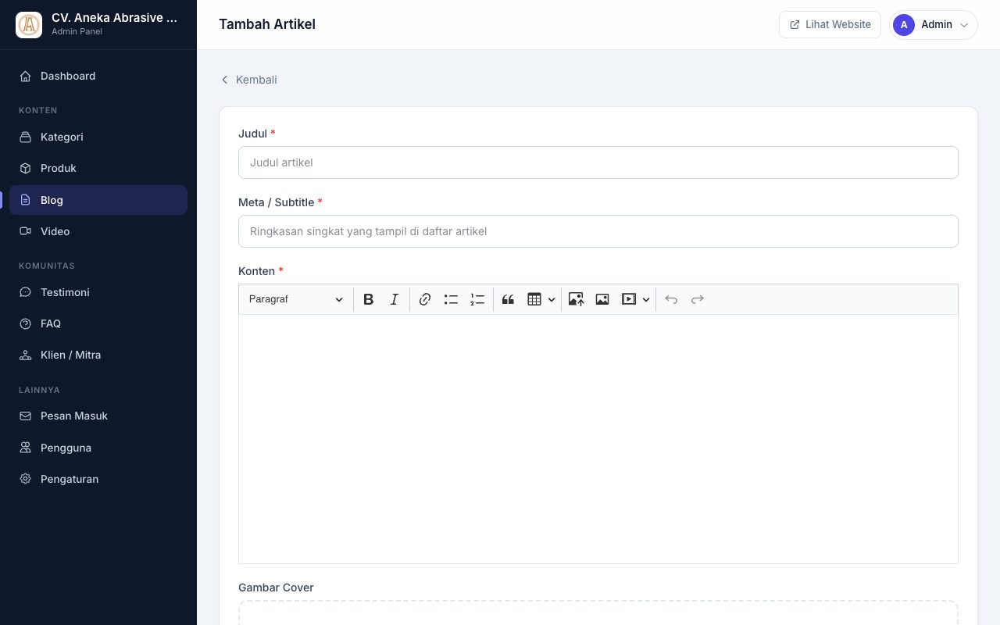

| Kolom | Keterangan |
|---|---|
| **Judul** | Judul artikel. |
| **Meta / Subtitle** | Ringkasan singkat atau kategori artikel, tampil di daftar artikel. |
| **Konten** | Isi artikel, ditulis dengan editor (lihat di bawah). Tidak boleh kosong. |
| **Gambar Cover** | Foto sampul artikel, maksimal 2 MB. Disarankan agar kartu artikel tidak memakai foto bawaan. |

**Tombol editor:**

| Tombol | Fungsi |
|---|---|
| Paragraf / Heading 2 / Heading 3 | Gaya teks dan sub-judul |
| **B** dan *I* | Tebal dan miring |
| Link | Menautkan teks ke alamat lain |
| Daftar berpoin / bernomor | Membuat daftar |
| Kutipan | Blok kutipan |
| Tabel | Menyisipkan tabel |
| Upload gambar | Mengunggah foto dari komputer. Bisa juga *tempel (paste)* atau *seret* foto langsung ke editor |
| Gambar dari URL | Menyisipkan gambar dari link (harus berawalan `https://`) |
| Sisipkan media | Menyisipkan video YouTube atau Vimeo lewat link |
| Undo / Redo | Membatalkan dan mengulang |

> Editor memerlukan koneksi internet karena dimuat dari layanan CKEditor. Jika kolom konten tampak kosong, segarkan halaman dengan Cmd/Ctrl + Shift + R.

Untuk mengubah artikel, klik **Edit** di daftar. Alamat artikel tidak berubah walau judulnya diedit.

---

## 1.7 Video

Video YouTube yang tampil di beranda (bagian *Video Produk*) dan dapat diputar langsung di website.

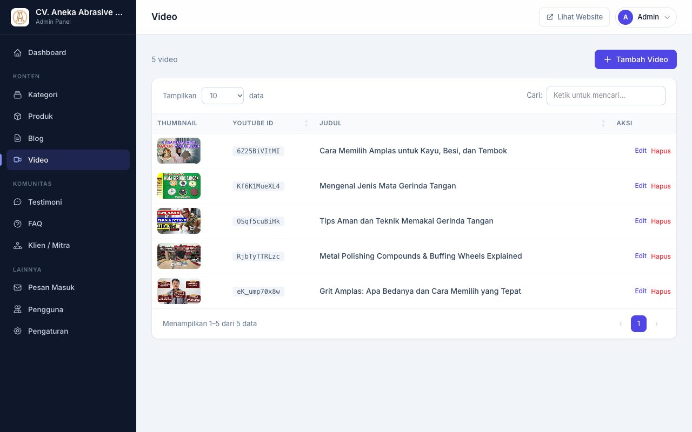

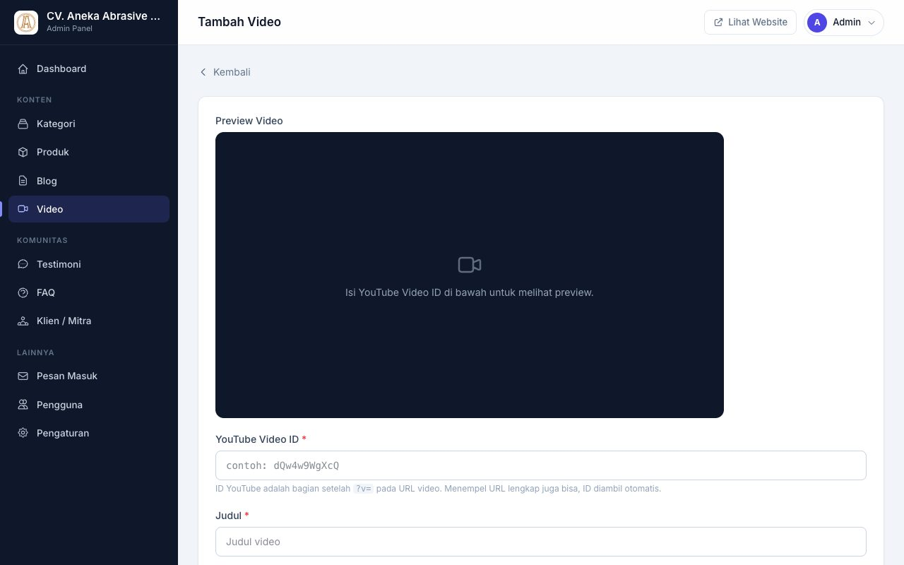

| Kolom | Keterangan |
|---|---|
| **YouTube Video ID** | Bagian setelah `?v=` pada alamat video. **Anda juga boleh menempel alamat lengkap YouTube**, ID diambil otomatis dan preview video langsung tampil. |
| **Judul** dan **Deskripsi** | Ditampilkan di bawah thumbnail video. |

ID video bisa diubah kemudian lewat **Edit**. Bagian Video di beranda otomatis tersembunyi bila belum ada video.

---

## 1.8 Testimoni dan link testimoni untuk klien

Menu **Testimoni** mengelola ulasan klien yang tampil di beranda. Ada dua cara menambah testimoni.

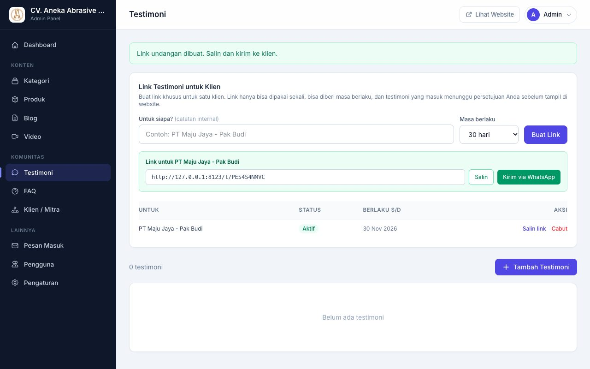

### Cara 1: Klien mengisi sendiri lewat link privat (disarankan)

1. Di kartu **Link Testimoni untuk Klien**, isi **Untuk siapa?** (catatan internal, misalnya `PT Maju Jaya - Pak Budi`) dan pilih **Masa berlaku** (7, 14, 30, 90 hari, atau tanpa batas).
2. Klik **Buat Link**. Link baru muncul di kotak hijau.
3. Klik **Salin** lalu kirim ke klien, atau klik **Kirim via WhatsApp** (pesan ajakan sudah terisi otomatis).
4. Klien membuka link, mengisi nama, jabatan dan perusahaan, serta testimoni, lalu mencentang persetujuan.

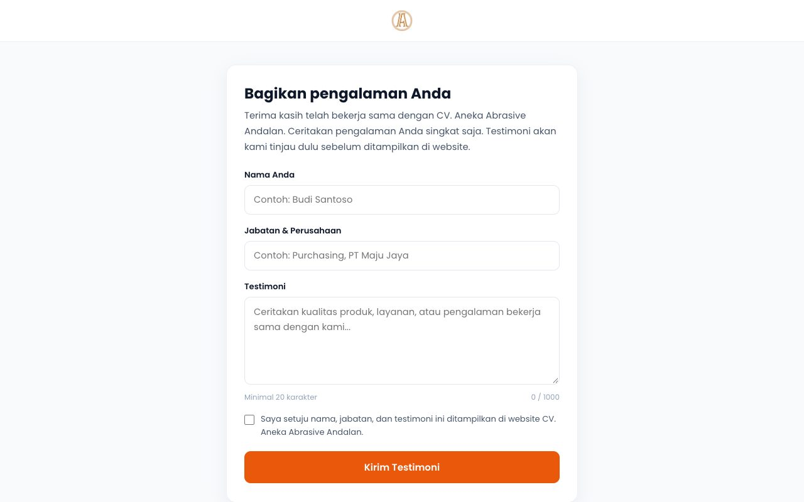

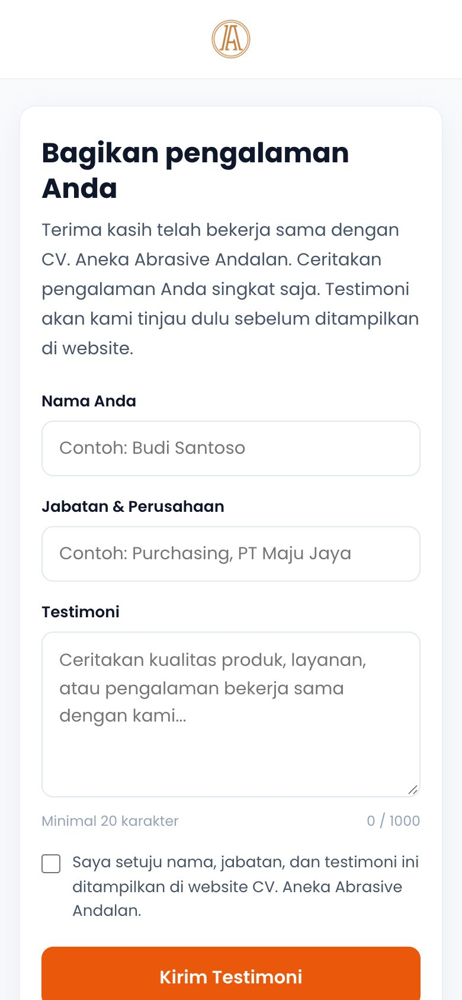

5. Testimoni yang masuk berstatus **Menunggu** (badge kuning) dan **belum tampil** di website. Klik **Setujui** agar tampil, atau **Hapus** untuk menolak.

Aturan link:

- **Sekali pakai.** Setelah klien mengirim testimoni, link tidak bisa dipakai lagi.
- **Ada masa berlaku.** Setelah lewat, link menampilkan pesan "kedaluwarsa".
- **Bisa dicabut.** Klik **Cabut** pada daftar link bila link salah kirim.
- Status link: **Aktif**, **Terpakai**, atau **Kedaluwarsa**.
- Link tidak muncul di Google dan kodenya tidak bisa ditebak.
- Jika email server sudah diatur, Anda menerima email setiap ada testimoni baru.

### Cara 2: Menambah sendiri

Klik **Tambah Testimoni**, isi nama, jabatan, dan isi testimoni, lalu **Simpan**. Testimoni yang ditambah admin langsung tampil.

> Bagian Testimoni di beranda otomatis tersembunyi bila belum ada testimoni yang disetujui.

---

## 1.9 FAQ

Pertanyaan yang sering diajukan, tampil di beranda sebagai daftar yang bisa dibuka-tutup.

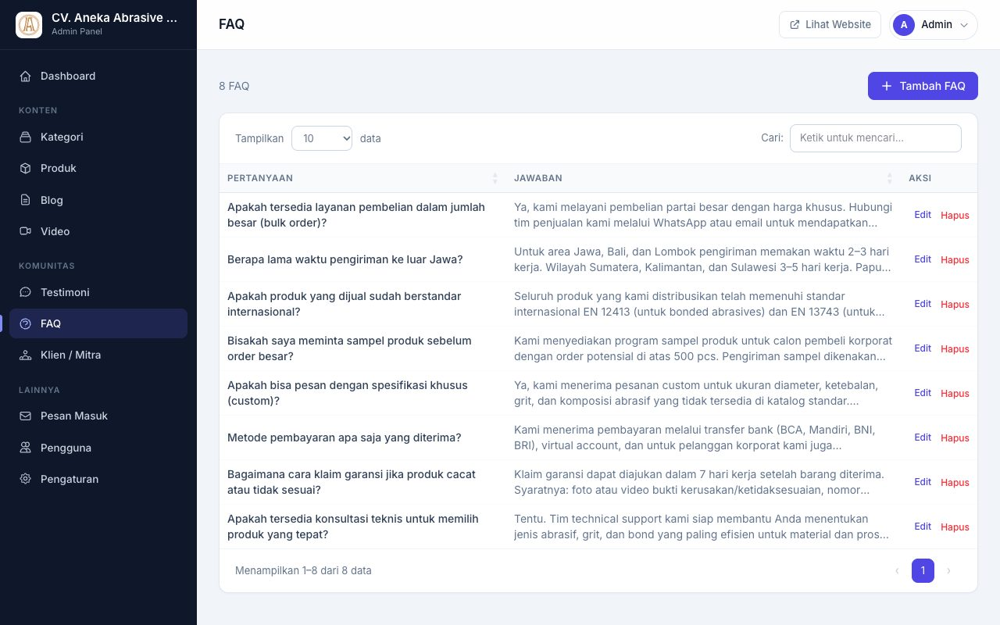

Klik **Tambah**, isi **Pertanyaan** dan **Jawaban**, lalu **Simpan**. Gunakan **Edit** atau **Hapus** untuk mengubah isinya.

---

## 1.10 Klien / Mitra

*Khusus Superuser.* Daftar perusahaan yang pernah bekerja sama. Tampil di beranda pada bagian *Klien Kami* sebagai deretan logo yang bergerak.

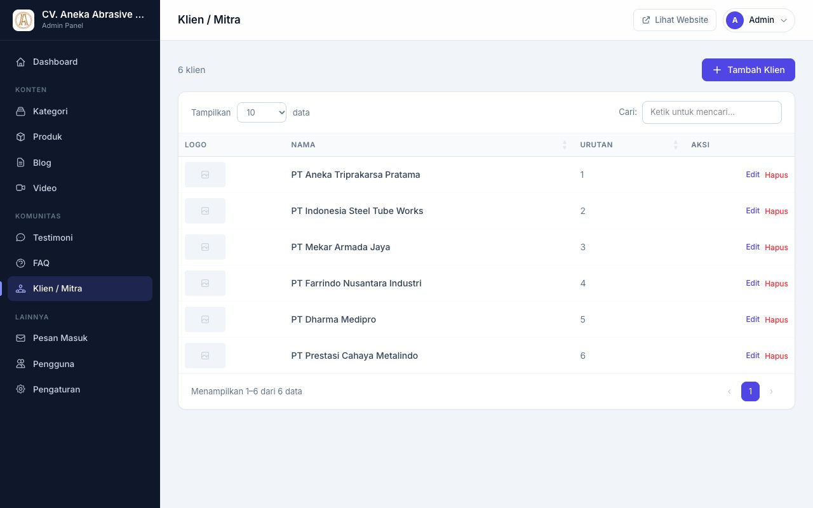

| Kolom | Keterangan |
|---|---|
| **Nama Perusahaan / Klien** | Nama yang tampil. |
| **Logo Perusahaan** | Wajib saat menambah. Disarankan logo dengan latar transparan (PNG). |
| **Urutan Tampil** | Angka kecil tampil lebih dulu. |

---

## 1.11 Pesan Masuk

Semua pesan dari form **Hubungi Kami** di website masuk ke sini.

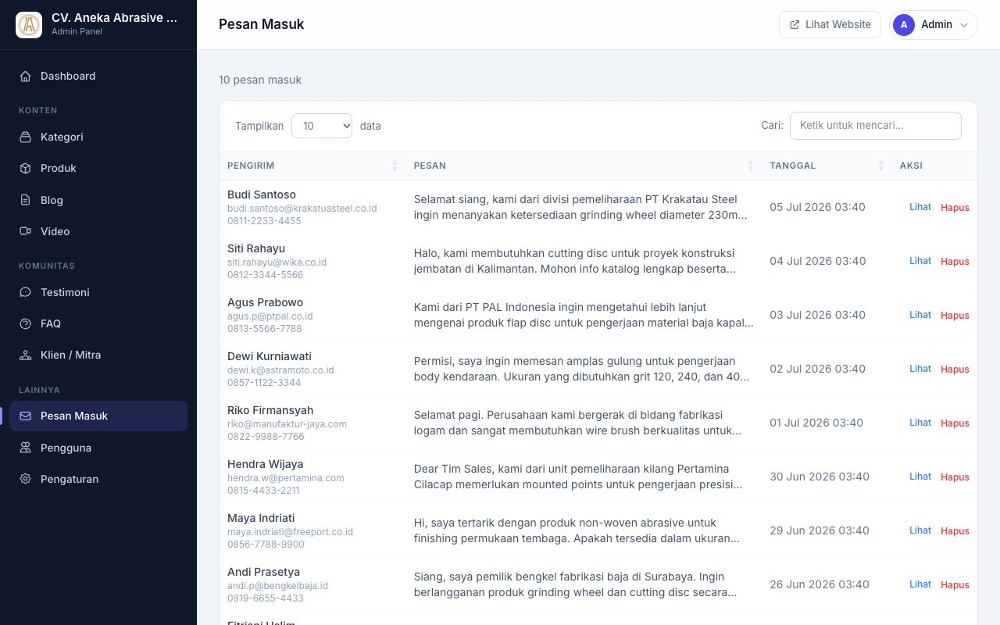

Klik **Lihat** untuk membuka isi pesan. Di halaman detail Anda dapat:

- melihat nama, email, telepon, **keperluan** yang dipilih pengirim, dan isi pesan,
- **membalas lewat email** langsung dari sini (isi *Subjek* dan *Isi balasan*). Fitur ini memerlukan pengaturan email server,
- **membalas lewat WhatsApp** dengan tombol hijau,
- **menghapus** pesan.

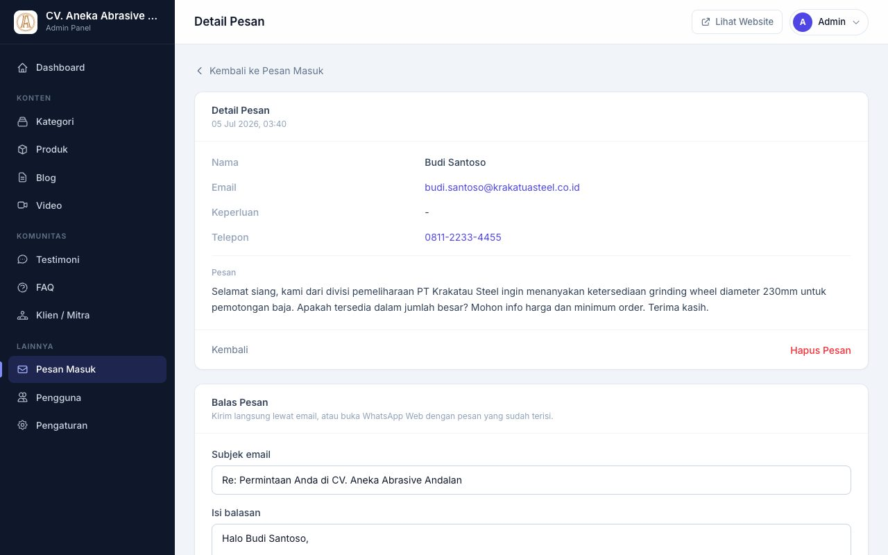

---

## 1.12 Pengguna

*Khusus Superuser.* Mengelola siapa saja yang bisa masuk ke Panel Admin.

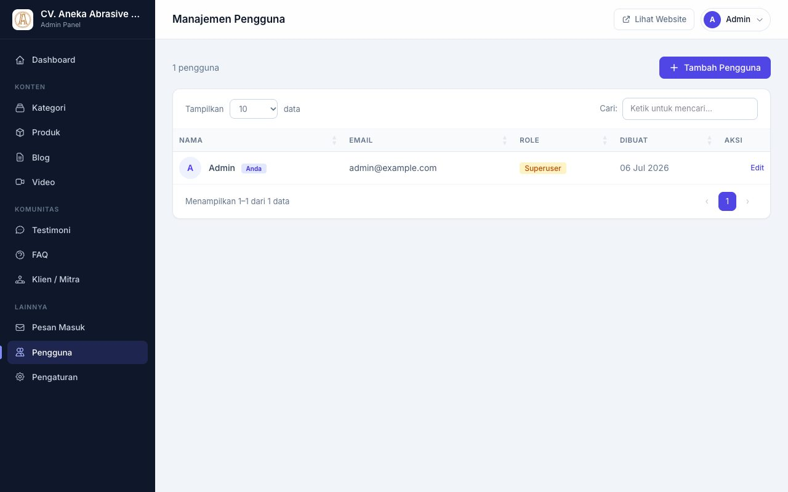

Klik **Tambah**, isi **Nama**, **Email**, **Role** (Admin atau Superuser), dan **Password**. Berikan peran *Superuser* hanya kepada orang yang boleh mengubah pengaturan website dan kategori.

---

## 1.13 Pengaturan Website

*Khusus Superuser.* Hampir semua teks dan tampilan di website diatur di sini. Pengaturan dibagi dalam **tab**. Klik **Simpan Pengaturan** (tombol biru di bagian bawah) setelah mengubah. Tombol ini tetap terlihat saat Anda menggulir halaman.

### Identitas

Nama perusahaan (pendek dan lengkap), tagline, dan **logo**. Logo tampil di header, footer, halaman login, dan halaman error.

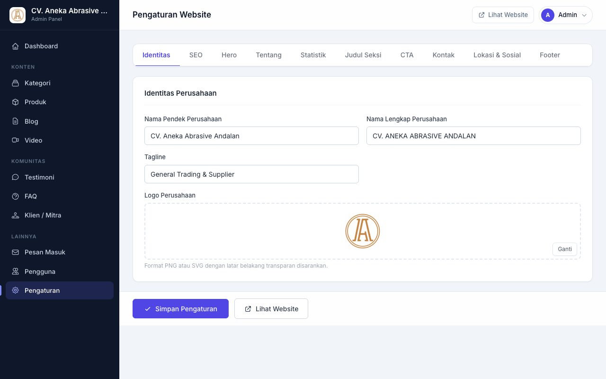

### SEO

Mengatur tampilan website di Google dan saat dibagikan.

- **Judul SEO** dan **Deskripsi SEO**: teks yang muncul di hasil pencarian (judul maksimal 70 karakter, deskripsi maksimal 200 karakter).
- **Kata Kunci**, **Gambar Preview Share** (gambar saat link dibagikan di WhatsApp atau media sosial), dan **Favicon** (ikon kecil di tab browser).
- **Google Search Console**, **Bing Webmaster**, dan **Google Analytics (GA4)**: isi kode dari layanan tersebut bila dipakai.

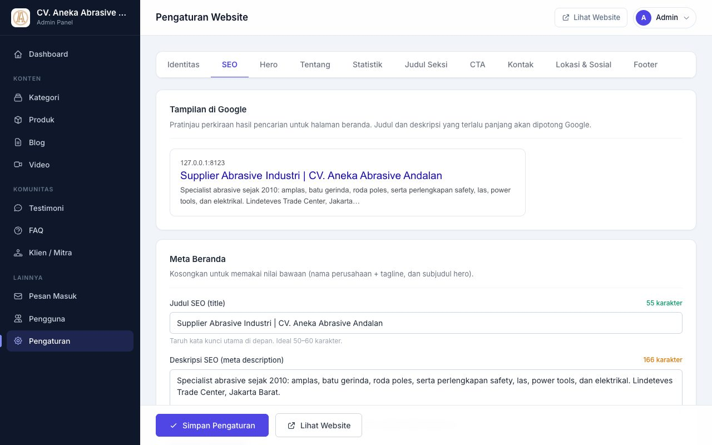

### Hero

Bagian paling atas beranda: **gambar latar**, **judul**, **deskripsi**, serta teks **tombol utama** dan **tombol sekunder**. Pada judul, bungkus kata yang ingin berwarna oranye dengan `kata`.

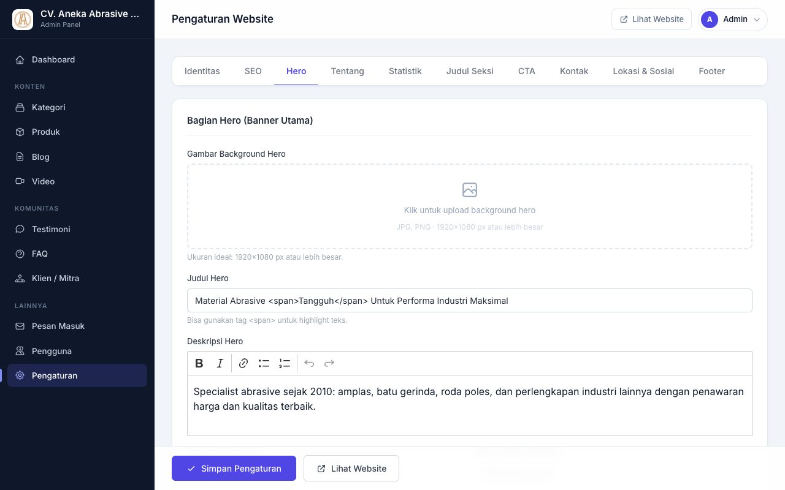

### Tentang

Isi halaman **Tentang Kami**: judul, deskripsi, **Visi** dan **Misi** (satu poin per baris), 4 keunggulan perusahaan, sertifikasi (maksimal 3, boleh dikosongkan), dan foto.

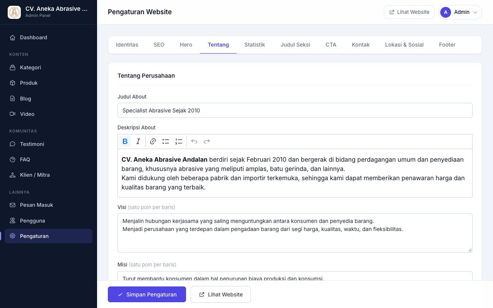

### Statistik

Angka ringkas di beranda: tahun pengalaman, jumlah klien, jumlah varian produk, dan persentase pengiriman tepat waktu. Isi hanya dengan angka yang benar. Anda dapat menyembunyikan seluruh bagian ini di tab *Judul Seksi*.

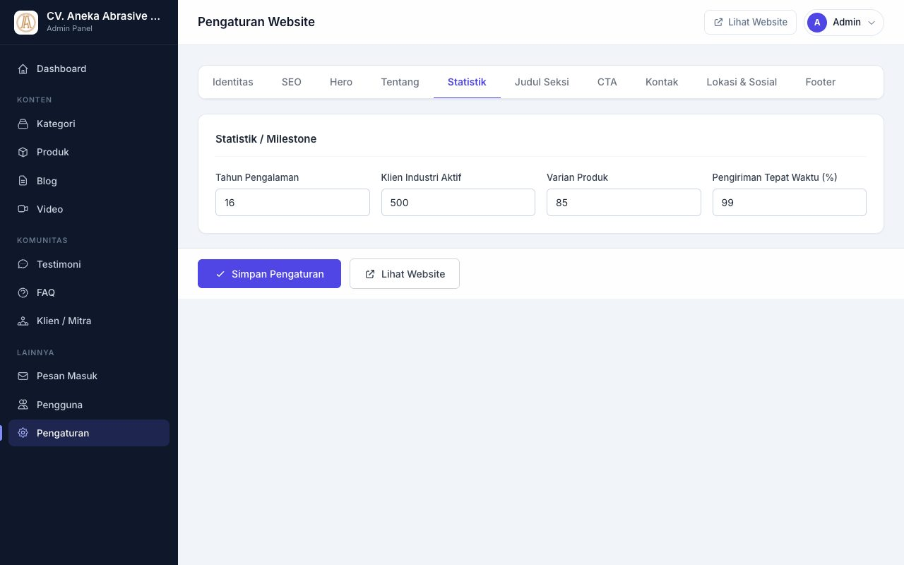

### Judul Seksi

Mengatur **judul dan deskripsi** tiap bagian beranda, dan **sakelar untuk menampilkan atau menyembunyikan** bagian itu: Statistik, Kategori, Produk, Video, Banner CTA, Klien, Testimoni, FAQ, Blog, dan Kontak. Bagian yang datanya masih kosong tetap otomatis tersembunyi.

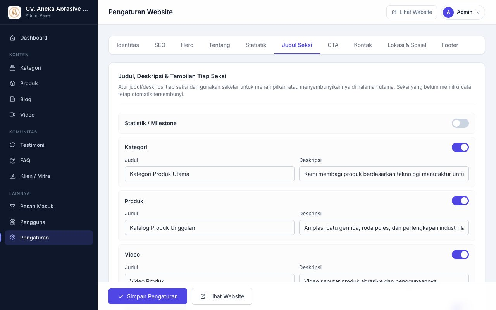

### CTA

Banner ajakan di beranda: judul, deskripsi, dan **File E-Catalog (PDF)**. Setelah PDF diunggah, tombol **Download E-Catalog** di website mengunduh file itu. Bila belum ada file, tombol hanya menuju form kontak.

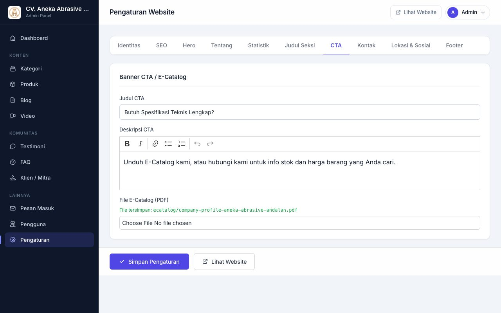

### Kontak

Judul dan deskripsi bagian kontak, **alamat**, **telepon**, **email**, dan **nomor WhatsApp**.

- Nomor WhatsApp ditulis dengan awalan kode negara tanpa tanda `+` atau spasi, misalnya `6281234567890`. Jika dikosongkan, semua tombol WhatsApp di website otomatis disembunyikan.
- Email di sini adalah tujuan notifikasi pesan masuk dan testimoni baru.

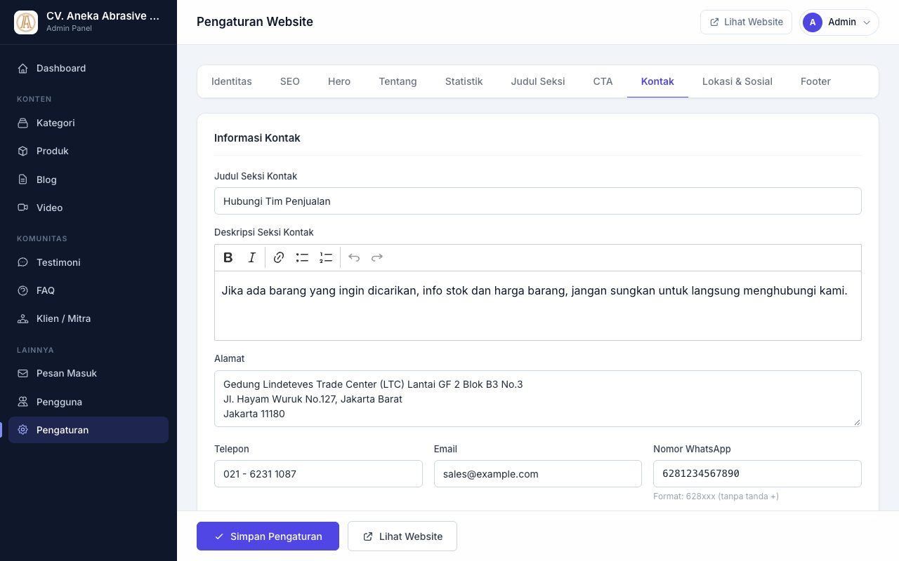

### Lokasi & Sosial

Jam operasional, kota, kode pos, **lokasi di peta** (klik peta atau isi koordinat), dan alamat media sosial (Facebook, Instagram, LinkedIn, YouTube, TikTok, X). Ikon media sosial hanya tampil untuk yang diisi, dan alamatnya harus berawalan `https://`.

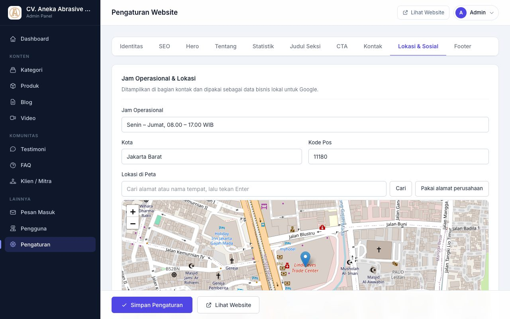

### Footer

Teks hak cipta di bagian paling bawah website.

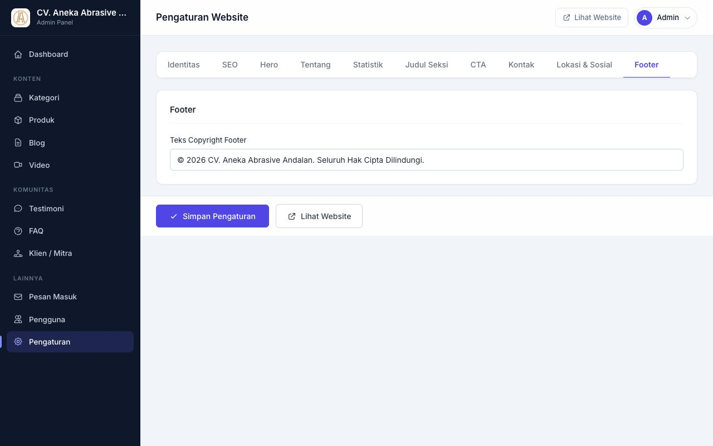

---

## 1.14 Akun saya

Klik nama Anda di pojok kanan atas, lalu **Pengaturan akun**. Di sini Anda dapat mengubah nama, email, dan password. Untuk mengubah password, isi password saat ini lalu password baru dua kali.

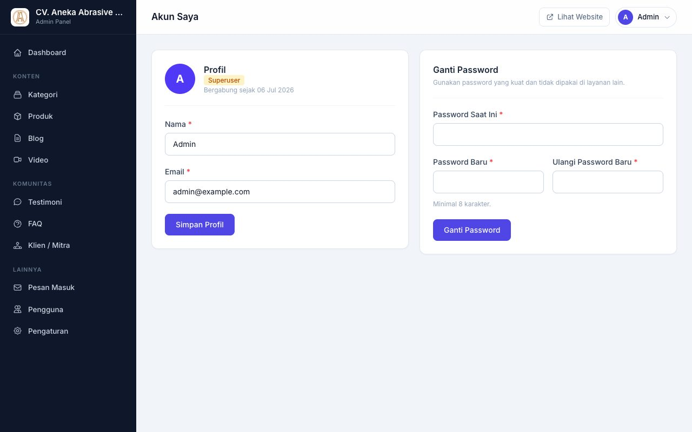

---

## 1.15 Tanya jawab singkat

**Perubahan tidak muncul di website?** Segarkan halaman dengan Cmd/Ctrl + Shift + R. Jika masih sama, pastikan Anda menekan tombol **Simpan**.

**Bagian beranda hilang?** Bagian yang datanya kosong (misalnya Video atau Testimoni) otomatis tersembunyi. Cek juga sakelarnya di *Pengaturan, Judul Seksi*.

**Tombol WhatsApp hilang?** Nomor WhatsApp di *Pengaturan, Kontak* kosong.

**Foto gagal diunggah?** Pastikan ukuran maksimal 2 MB dan formatnya JPG, PNG, atau WebP.

**Tidak bisa membuka Pengaturan, Kategori, Klien, atau Pengguna?** Menu itu khusus Superuser. Minta Superuser menaikkan peran Anda.

**Email balasan atau notifikasi tidak terkirim?** Pengaturan email server (SMTP) di berkas `.env` belum diisi. Hubungi pengembang (lihat [Panduan Teknis](03-panduan-teknis.md#33-daftar-periksa-sebelum-website-tayang)).
