# 2. Panduan Website (Tampilan untuk Pengunjung)

Bagian ini menjelaskan isi website yang dilihat pengunjung, dan **dari menu admin mana tiap bagian diatur**. Website punya dua desain yang dipilih otomatis: **desktop** (komputer dan tablet) dan **mobile** (ponsel).

**Daftar isi**

1. [Beranda (desktop)](#21-beranda-desktop)
2. [Katalog produk](#22-katalog-produk)
3. [Detail produk](#23-detail-produk)
4. [Blog](#24-blog)
5. [Tentang Kami](#25-tentang-kami)
6. [Formulir testimoni (link privat)](#26-formulir-testimoni-link-privat)
7. [Halaman tidak ditemukan](#27-halaman-tidak-ditemukan)
8. [Tampilan mobile](#28-tampilan-mobile)

---

## 2.1 Beranda (desktop)

Beranda terdiri dari beberapa bagian dari atas ke bawah. Setiap bagian bisa dimatikan di *Pengaturan, Judul Seksi*, dan bagian yang belum ada datanya otomatis tersembunyi.

### Hero (bagian paling atas)

Judul besar, deskripsi, dan dua tombol. Tombol WhatsApp melayang di pojok kanan bawah.

| Bagian | Diatur di |
|---|---|
| Gambar latar, judul, deskripsi, teks tombol | Admin, *Pengaturan, Hero* |
| Logo dan nama perusahaan | Admin, *Pengaturan, Identitas* |
| Tombol WhatsApp melayang | Admin, *Pengaturan, Kontak* (nomor WhatsApp) |

### Kategori Produk

Kartu kategori. Mengklik kartu langsung menyaring katalog di bawahnya.

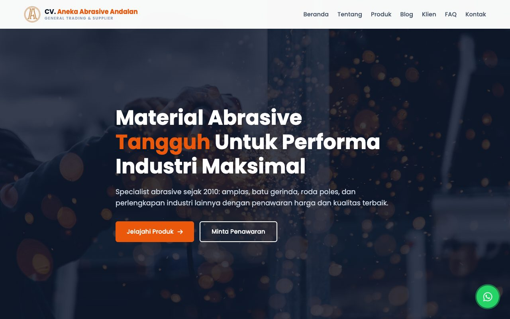

Diatur di: Admin, **Kategori**.

### Katalog Produk

Tombol kategori di atas menyaring produk. Produk diambil dari server saat kategori diklik, sehingga semua kategori selalu menampilkan produknya. Tersedia dua tampilan: **kotak (thumbnail)** dan **daftar**. Pilihan tampilan diingat browser. Tombol *Lihat Semua Produk* membuka katalog lengkap.

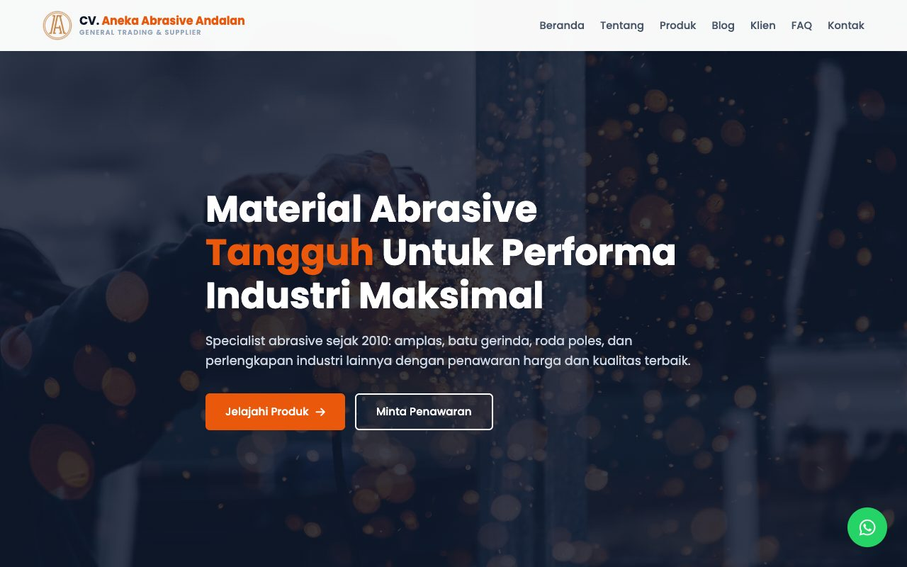

Diatur di: Admin, **Produk**, dan judul seksinya di *Pengaturan, Judul Seksi*.

### Video, E-Catalog, Klien, Testimoni, FAQ, dan Blog

- **Video Produk**: thumbnail YouTube yang diputar dalam jendela di halaman. Diatur di *Video*.
- **Banner E-Catalog**: tombol *Download E-Catalog (PDF)* dan *Minta via WhatsApp*. Diatur di *Pengaturan, CTA*.
- **Klien Kami**: deretan logo yang bergerak. Diatur di *Klien / Mitra*.

- **Testimoni**: kartu ulasan klien. Diatur di *Testimoni*.
- **FAQ**: pertanyaan yang bisa dibuka-tutup. Diatur di *FAQ*.

- **Blog**: 4 artikel terbaru dan tombol **Lihat Semua Artikel** ke halaman `/blog`. Diatur di *Blog*.

### Kontak

Informasi alamat, telepon, email, jam operasional, peta, dan **formulir Hubungi Kami**.

Formulir berisi nama, email, telepon, **keperluan** (Permintaan Penawaran, Tanya Produk, Kerja Sama / Distributor, atau Lainnya), dan pesan. Pesan yang dikirim masuk ke Admin, menu **Pesan Masuk**. Formulir dilindungi dari spam (batas 5 kiriman per menit dan kolom jebakan bot).

Informasi kontak diatur di *Pengaturan, Kontak* dan *Pengaturan, Lokasi & Sosial*.

---

## 2.2 Katalog produk

Alamat: `/products`. Pengunjung dapat **mencari** produk, **menyaring** per kategori, dan membuka detail produk. Hasil dibagi per halaman (12 produk per halaman).

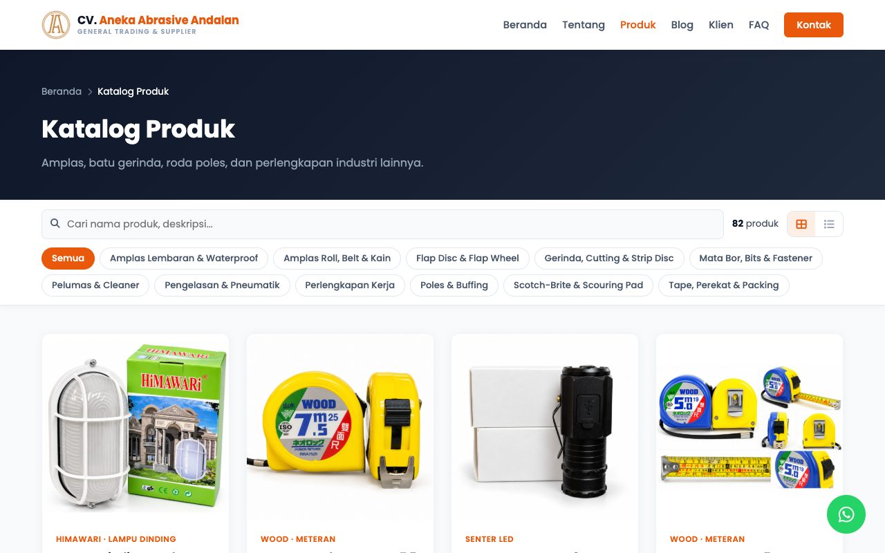

Diatur di: Admin, **Produk** dan **Kategori**.

---

## 2.3 Detail produk

Setiap produk punya halaman sendiri dengan alamat dari judulnya, misalnya `/products/nama-produk`. Isinya:

- **Galeri foto** dengan tombol panah dan gambar kecil. Klik foto untuk **memperbesar (zoom)**, lalu geser atau cubit untuk memperbesar.
- Merek, kategori, judul, dan deskripsi.
- **Spesifikasi**: label dan nilai utama, kecepatan maksimum (jika ada), dan material atau aplikasi.
- Tombol **Pesan via WhatsApp** (nama produk sudah terisi di pesan) dan **Minta Penawaran** (membuka formulir kontak dengan pesan yang sudah terisi nama produk).
- **Produk Serupa** dari kategori yang sama.

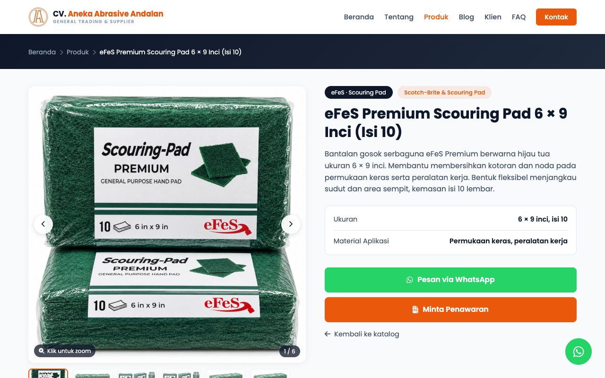

Diatur di: Admin, **Produk**.

---

## 2.4 Blog

### Daftar artikel

Alamat: `/blog`. Menampilkan semua artikel, 9 per halaman.

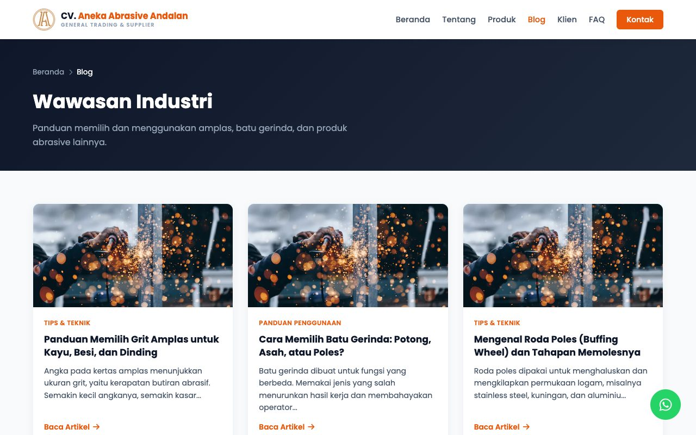

### Halaman artikel

Setiap artikel punya alamat sendiri (`/blog/judul-artikel`) sehingga bisa dibagikan dan ditemukan lewat Google. Di bawah artikel ada tombol bagikan (WhatsApp, Facebook, salin link) dan **Artikel Lainnya**.

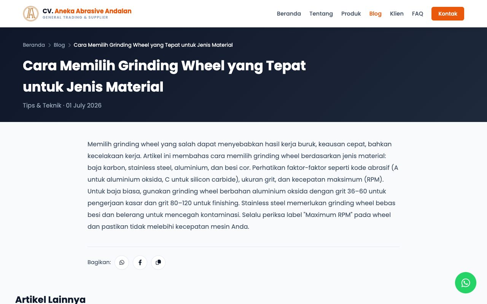

Diatur di: Admin, **Blog**.

---

## 2.5 Tentang Kami

Alamat: `/tentang`. Berisi profil perusahaan, keunggulan, **visi dan misi**, sertifikasi (jika diisi), statistik (jika dinyalakan), dan ajakan menghubungi.

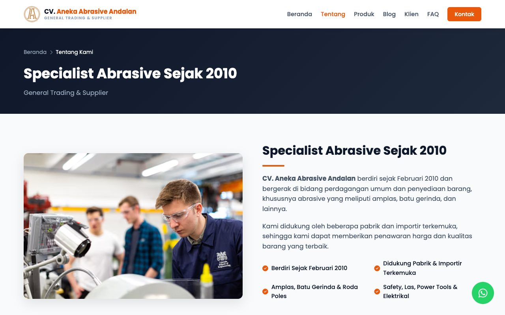

Diatur di: Admin, *Pengaturan, Tentang* dan *Pengaturan, Statistik*.

---

## 2.6 Formulir testimoni (link privat)

Halaman ini **tidak ada di menu website**. Klien hanya bisa membukanya lewat link khusus (`/t/KODE`) yang Anda buat di Admin. Lihat langkah lengkapnya di [Panduan Admin, bagian Testimoni](01-panduan-admin.md#18-testimoni-dan-link-testimoni-untuk-klien).

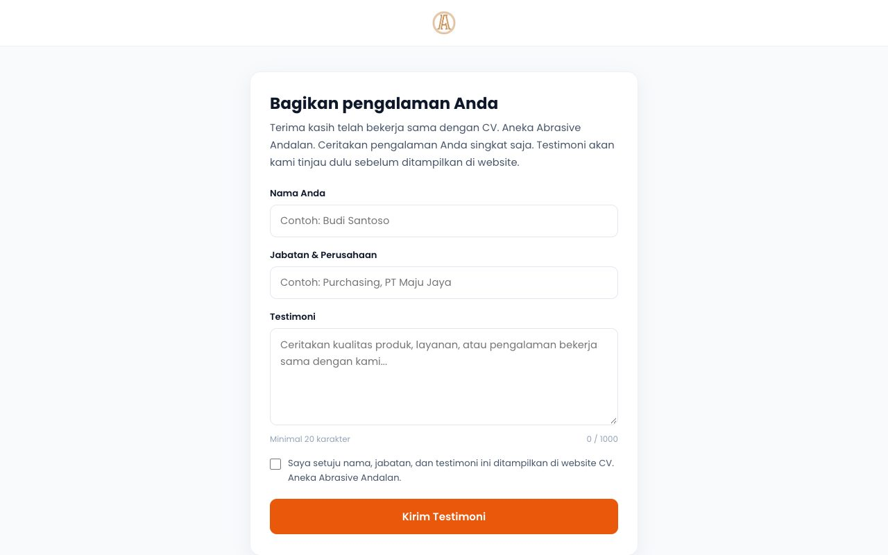

Halaman ini otomatis menyesuaikan layar ponsel dan menampilkan pesan yang jelas jika link sudah dipakai, kedaluwarsa, atau tidak valid.

---

## 2.7 Halaman tidak ditemukan

Alamat yang salah menampilkan halaman 404 yang rapi, lengkap dengan tombol kembali ke beranda, katalog produk, dan WhatsApp. Halaman serupa juga tersedia untuk kesalahan lain (akses ditolak, sesi habis, terlalu banyak permintaan, gangguan server, dan pemeliharaan).

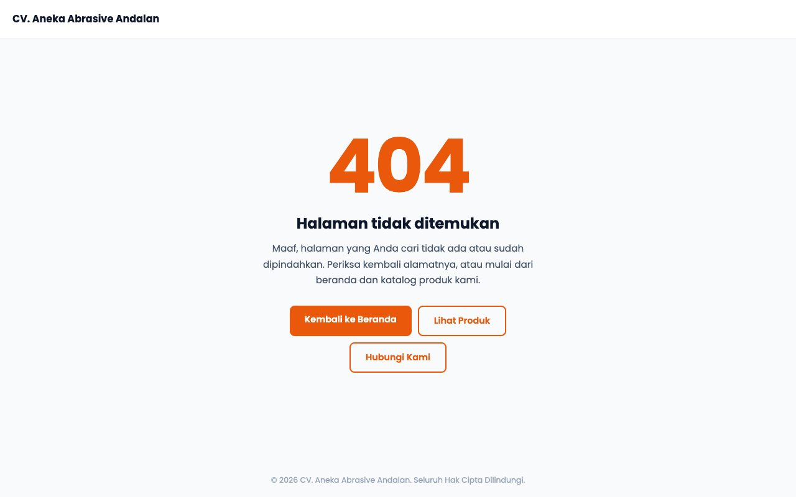

---

## 2.8 Tampilan mobile

Di ponsel, website tampil seperti aplikasi: **bilah menu bawah** (Beranda, Produk, Tentang, Kontak), kartu produk dua kolom, dan tombol aksi yang mudah dijangkau. Untuk mencoba dari komputer, tambahkan `?view=mobile` di akhir alamat.

### Beranda mobile

Beranda dibagi menjadi layar yang berpindah lewat bilah menu bawah, tanpa memuat ulang halaman.

<table>
<tr>
<td align="center">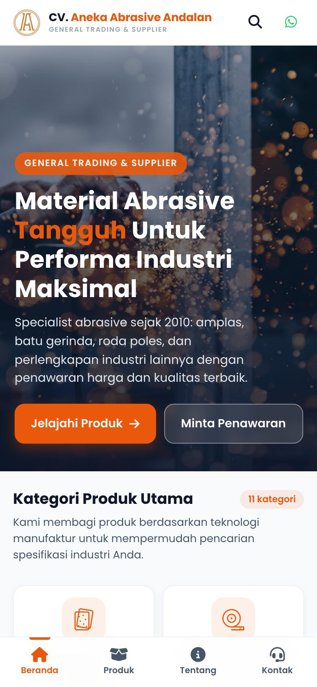 Beranda</td>
<td align="center">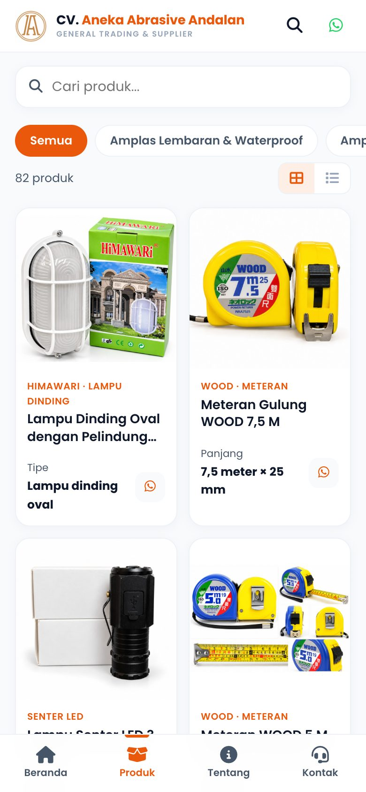 Produk (cari dan filter)</td>
<td align="center">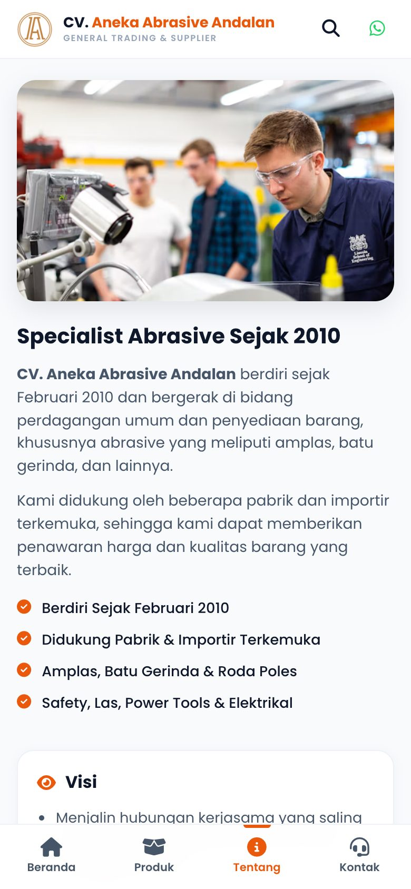 Tentang</td>
<td align="center">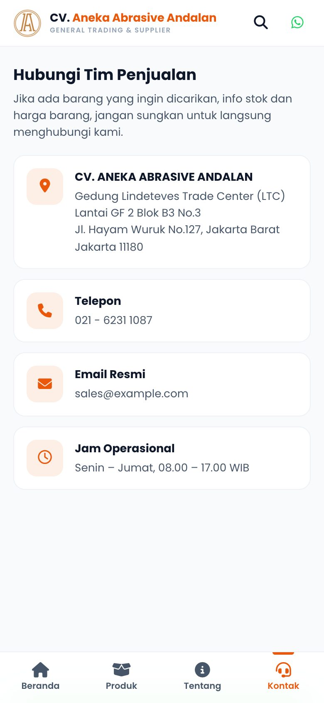 Kontak</td>
</tr>
</table>

### Halaman lain di mobile

<table>
<tr>
<td align="center">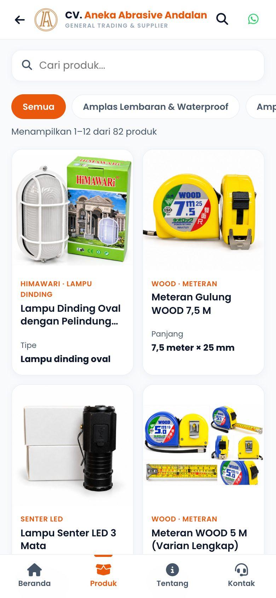 Daftar produk</td>
<td align="center">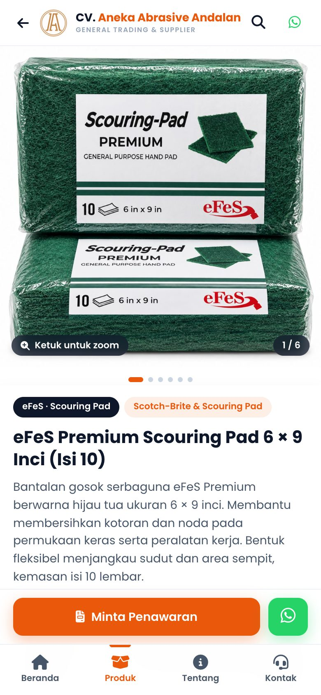 Detail produk</td>
<td align="center">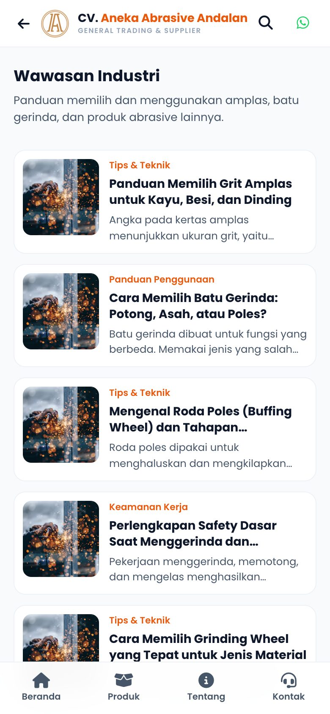 Daftar artikel</td>
<td align="center">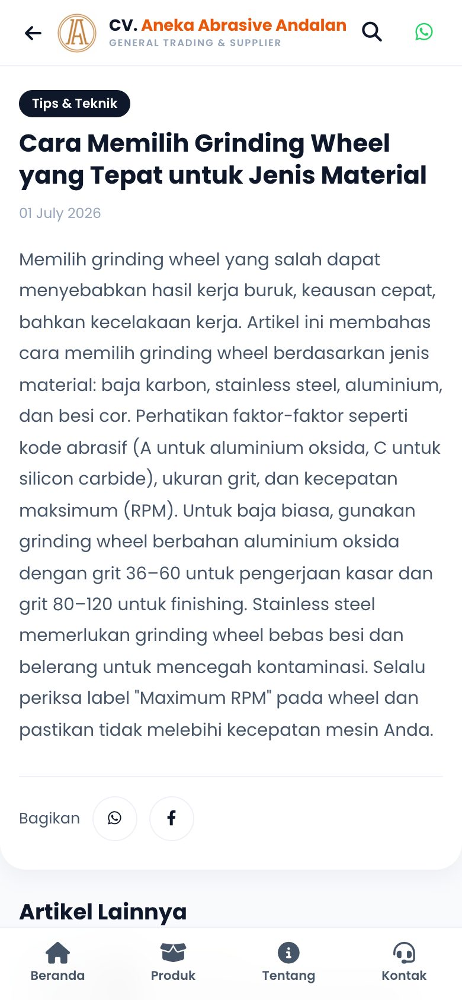 Artikel</td>
</tr>
</table>

Yang khas di mobile:

- **Detail produk**: foto digeser ke samping, dan di bagian bawah ada tombol **Minta Penawaran** serta tombol WhatsApp yang selalu terlihat.
- **Daftar produk**: kotak cari di atas, tombol kategori yang digeser ke samping, dan tombol *Sebelumnya / Berikutnya* di bawah.
- Tombol telepon dan WhatsApp ada di pojok kanan atas semua halaman.
